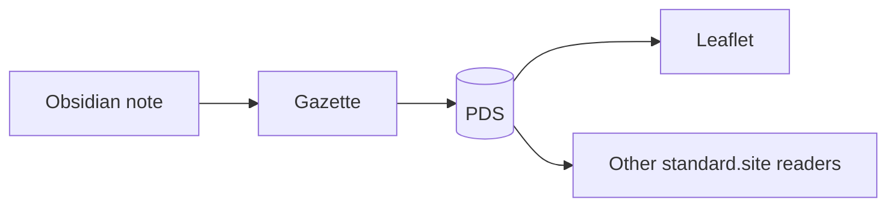

# Field Guide to Math and Code

A tour of the technical blocks. Inline math such as $e^{i\pi} + 1 = 0$ becomes inline code, display math becomes a real math block:

$$
\int_{-\infty}^{\infty} e^{-x^2}\,dx = \sqrt{\pi}
$$

## Hydration, the baker's percentage

The hydration of a dough is the water weight divided by the flour weight:

$$
h = \frac{m_{water}}{m_{flour}} \times 100
$$

## The same function, three ways

```python
def hydration(water: float, flour: float) -> float:
    return water / flour * 100
```

```typescript
export const hydration = (water: number, flour: number): number =>
	(water / flour) * 100;
```

```rust
fn hydration(water: f64, flour: f64) -> f64 {
    water / flour * 100.0
}
```

## How a post travels



## Typical hydrations

| Bread      | Hydration | Difficulty |
| :--------- | --------: | :--------: |
| Bagel      |       55% |    Easy    |
| Sandwich   |       65% |    Easy    |
| Sourdough  |       75% |   Medium   |
| Ciabatta   |       80% |  **Hard**  |
