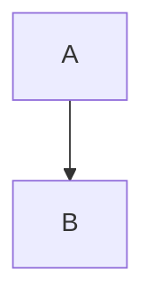

# Rich note

Café **gras é** and *italic* with ==highlight== and `code`.[^1]

> [!tip] Callout title
> Callout body

- [x] done
- [ ] todo
	1. nested

| Col | Value |
| --- | ----: |
| a   | 1     |



```dataview
LIST
```

![[pixel.png|A pixel|200]]

![[Snippet#Part]]

%% hidden %%

[^1]: The footnote.
